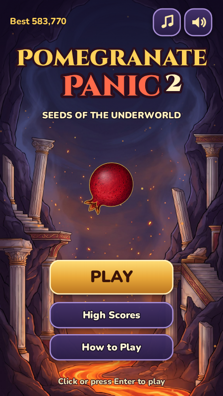
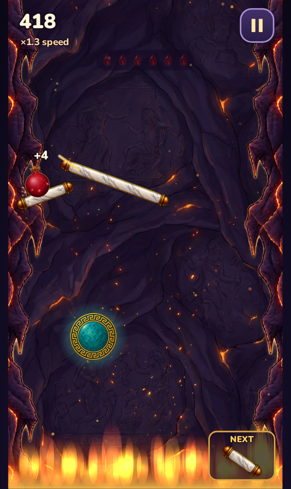
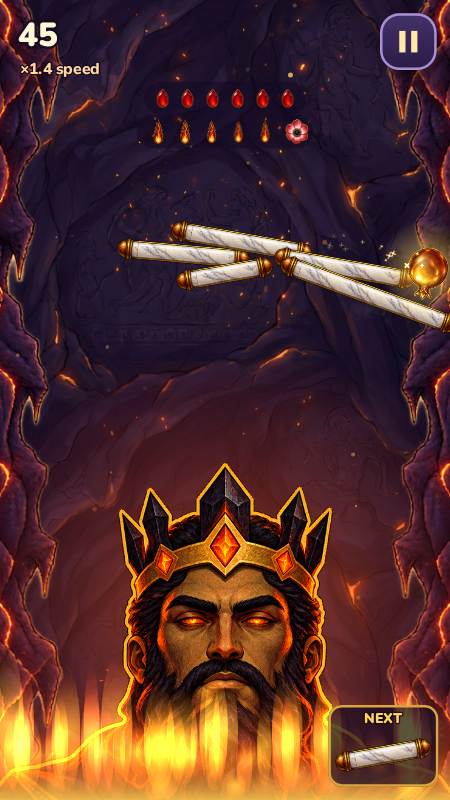
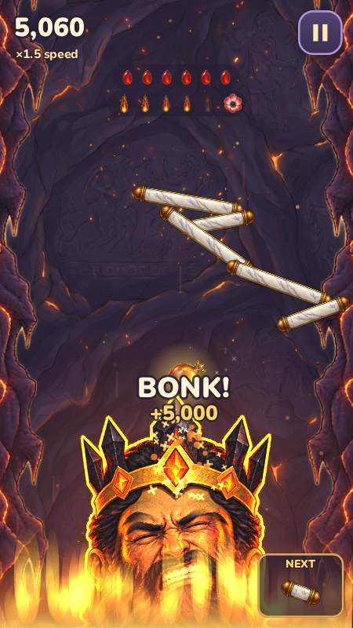
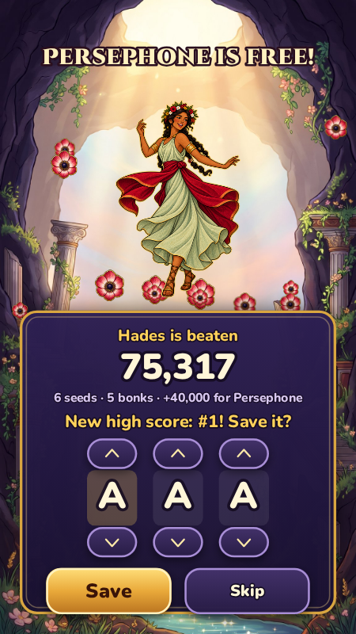
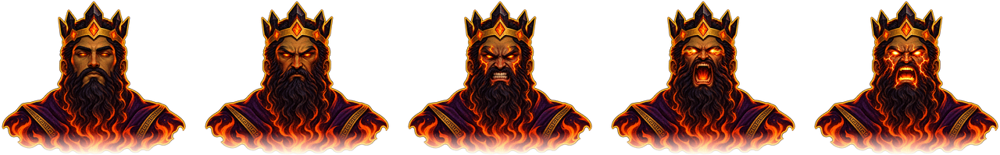
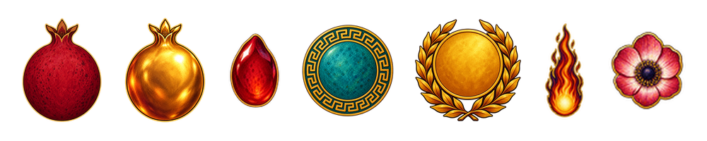
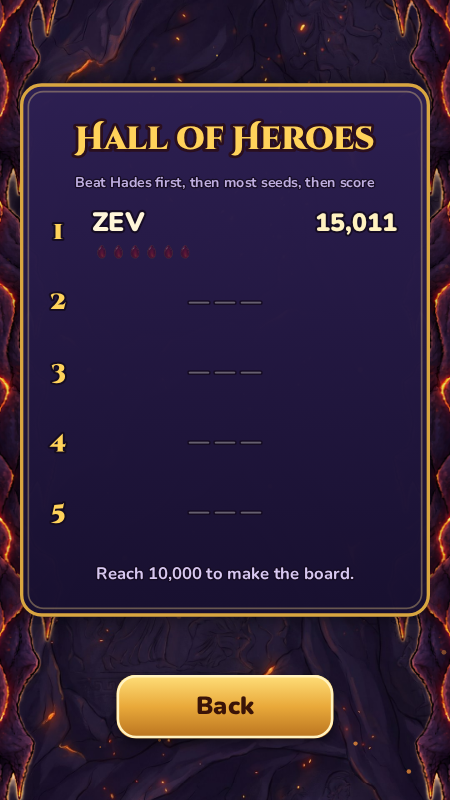
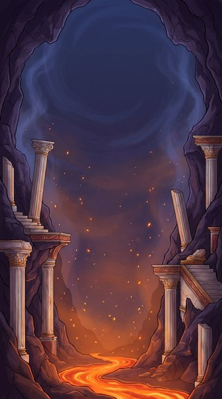
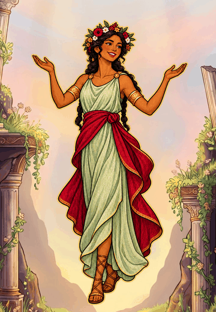

# Pomegranate Panic 2: Seeds of the Underworld

*Six seeds. One very angry god. Keep rolling.*

A pomegranate is tumbling down through the Greek underworld, and the only
thing between it and Hades' fire is you, slapping marble ramps into thin air.
Let it drop far and it bounces for points, ring the bronze bumpers for combos,
and grab Persephone's six stolen seeds. Then Hades himself rises out of the
flames, and you have to bounce that pomegranate off his face until he gives up
and lets Persephone go.

**[▶ Play Pomegranate Panic 2](https://pomegranatepanic2.synapticnoise.com)** in
your browser. No install, works on desktop and on phones (held upright).

It's the sequel to **[Pomegranate Panic](https://pomegranatepanic.synapticnoise.com)**.



## The underworld

| | |
|---|---|
|  **The descent.** It never stops and it keeps getting faster, music included. |  **Six seeds wake Hades.** His face rises up and fills the bottom of the screen. |
|  **Bounce off his face.** Five good bonks and he's beaten. Drop on him from high up for a CRITICAL. |  **Persephone goes free,** and spring breaks out all over the underworld. |

## The Lord of the Dead



Every bonk sends Hades sinking back into the fire, and every time he comes
back he's angrier. First his eyes start to glow. Then he spits fireballs that
burn your ramps away. Then he starts drifting from side to side so you have to
chase him. While he's down in the flames, a warm updraft helps you keep the
pomegranate up, and Persephone's blessing will save you from the fire once per
fight.

## The cast



- **The pomegranate.** Your hero. It rolls down every ramp you place and
  bounces when it falls a long way.
- **The golden pomegranate.** The sixth seed turns your pom to gold for the
  fight with Hades, and everything is worth double.
- **Seeds.** Persephone's six seeds, each worth more than the last. An arrow
  at the bottom of the screen shows when one is coming.
- **Bumpers.** Bronze rings that bounce you like a pinball and grow your combo.
- **The jackpot.** Hit the golden laurel five times for a big payout.
- **Fireballs.** Hades' angry spit. They burn up any ramp they hit.
- **Spring flowers.** What you get when you win.

## How to play

- **Place a ramp:** click (desktop) or tap (phone) below the pomegranate. The
  NEXT card shows the piece that's coming: its angle and length.
- **Hold and drag** on a phone, and the ghost ramp lifts above your finger so
  you can see exactly where it will go.
- **No spamming:** there's a tiny cooldown between ramps. Tap during it and
  your tap waits its turn; it isn't lost.
- **Combos:** let the pom fall a long way before catching it and it bounces
  for points. Chain bounces and bumpers for up to 10x.
- **Pause:** Esc or P, or the pause button. **Mute:** M, or the music and sound buttons.
- Found a bug? Pause and pick "Report a bug", or press Ctrl+Shift+F (you'll
  need a GitHub account).
- On a phone, play upright. You can install it from your browser's menu to
  play full screen, even offline.

You lose when the pomegranate falls into the fire. Beat Hades and the run ends
in victory. Your best score and settings are saved in your browser.

## The Hall of Heroes



Score 10,000 or more and you can carve your initials into the **Hall of
Heroes**, a top 5 kept in your browser. Beating Hades counts most, then how
many seeds you gathered, then your score. So a hero who freed Persephone
always outranks one who just scored big.

<br clear="right">

## How it was made

The whole game was made by [Claude Code](https://claude.com/claude-code) with
**[gamegen](https://github.com/zeveck/gamegen)**, a Claude Code plugin that
turns an idea into a finished game. The design, the art, the animation, the
music, the sound effects and every line of code came from this one command:

> /gg:gamegen We want to make Pomegranate Panic 2. It's based on https://pomegranatepanic.synapticnoise.com/. https://github.com/zeveck/pomegranatepanic. We want the same basic game idea, but with better graphics and sound fx and there should maybe be a tiny cooldown if you spam placement too fast. Also, if you get all 6 pomegranite seeds you should get to "fight" Hades. My idea there is that a Hades face will come up and fill the bottom of the screen and you just let yourself bounce off him, which throws you back up, and Hades vanishes for a bit then comes back, and gets angrier each time, and you do that enough times to defeat him and free Persephone or something. The music should probably get faster as the game does and there should be boss music. There should probably be the ability to capture your high score locally if you want and you're above a certain reasonably high threshold. Maybe it keeps top 5 with initials after you clear 10000 points or something. High score would probably care how many seeds you had and whether you beat hades.

That's it: no other instructions about the game, no hand-drawn art, no
hand-written code. From there, gamegen studied the original game, wrote a
design, had a team of reviewer agents (a player, a builder and an art
director) pick it apart over two rounds, then generated the art and audio,
built the game, and play-tested it on desktop and phone sizes. A test bot
played dozens of runs and boss fights to make sure Hades can always be beaten,
and a fresh playtester and bug hunter went over the result before it was
called done. One follow-up request published it here, and a later one added
the "Report a bug" button:

> /gamegen --feedback on --publish --no-confirm

gamegen brings four plugins along. Here's what each one made.

### [imagegen2](https://github.com/zeveck/imagegen2): the underworld folk

imagegen2 creates images with OpenAI's GPT Image. It drew the pomegranate
first, and the pomegranate then set the style for everything else: the marble
ramps, the bronze bumpers and golden jackpot, the seeds, the fireballs, the
rock walls, Persephone, and all of Hades' faces, from stern to raging.

### [nanogen](https://github.com/zeveck/nanogen): the cavern



nanogen creates images with Google's Gemini (Nano Banana). It painted the
underworld vista on the title screen, then repainted the same place as the
dark cavern you fall through, and again in full spring bloom for the victory.

<br clear="right">

### [anim8gen](https://github.com/zeveck/anim8gen): the celebration



anim8gen turns a character into short sprite animations. Starting from
imagegen2's Persephone, it drew her celebrating her freedom and checked every
frame so she stays the same Persephone.

<br clear="right">

### [audiogen](https://github.com/zeveck/audiogen): the sound

audiogen creates audio with ElevenLabs. It composed five pieces of music: a
title theme, the descent music (plus a more frantic version for when things
get fast), a thundering boss theme for Hades and a victory fanfare. The game
speeds the music up as the descent speeds up. audiogen also made all 27 sound
effects: ramp clacks, bounces, bumper rings, seed chimes, crackling fire,
crumbling marble, rumbling earthquakes, fireballs and one very satisfying
**[BONK on Hades](media/showcase/hades-bonk.mp3)**.

## Playing locally

Pomegranate Panic 2 is a plain web page with no build step. Serve the `game`
folder with any static web server, for example:

```sh
python3 -m http.server --directory game
```

Then open http://localhost:8000.

## Credits

- Fonts: [Cinzel Decorative](https://fonts.google.com/specimen/Cinzel+Decorative)
  and [Nunito](https://fonts.google.com/specimen/Nunito), SIL Open Font
  License (licenses in `game/fonts/`).
- Based on the original [Pomegranate Panic](https://github.com/zeveck/pomegranatepanic).
- Code: MIT License (see `LICENSE`).
